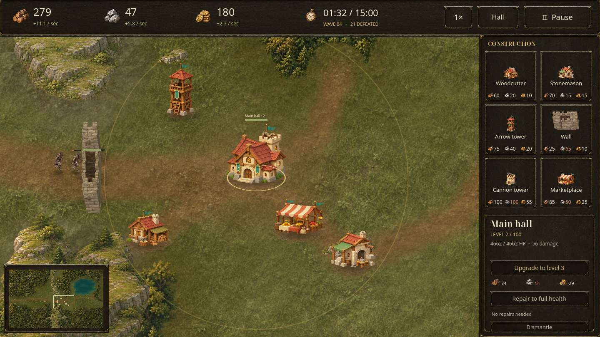
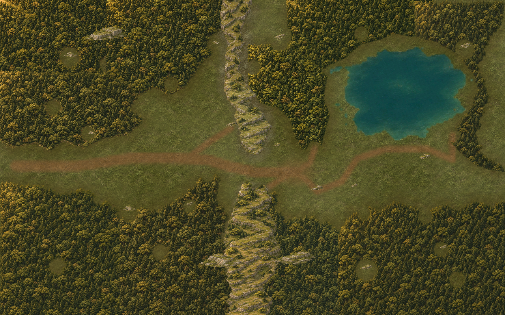

# Tabara: Last Hearth — Woodland Basin

An offline Android settlement-defense game built in **Godot 4.6.3**. Establish a
foothold in a large wooded valley, gather supplies, place your own defenses, and
hold the main hall for **15 in-game minutes**. Victory unlocks endless survival.



## The woodland revision

Version **0.7.0** replaces the original fixed plots with an **8,192 × 5,120** world,
about **54 times the original map area**. Defenses use a visible construction grid on clear
land. Woodcutters and stonemasons occupy matching resource deposits, one per site. Pan and zoom around forests, quarries, rocky ridges, a lake, and the single
western entry. New mountain spines form a 480-unit pass that can be sealed with walls. Attackers route around impassable forests, rocks, mountains and water, then break through standing buildings in their way. A minimap provides fast travel across the valley.

The new map is composed as one temperate woodland basin: connected pine and oak
belts enclose broad buildable meadows, low mossy grey limestone defines the pass,
and the eastern forest follows the lake. Resource outcrops share that geology;
woodcutters use marked working pockets in the forest. The unrelated chapel,
windmill, arch and decorative ruins have been removed from new settlements.
Forest edges, resource cores, cliffs and shorelines all affect movement. The
minimap is rendered from the actual game landscape.



Walls use textured stone faces, raised wooden walkways, crenellated parapets,
and reinforced end/corner piers. Connected sections share their boundaries;
wall runs are drawn as fortification geometry rather than cropped wall strips.

## Play

Download the [tested Android APK](https://raw.githubusercontent.com/Mirne/Tabara/master/builds/tabara-frontier-v0.7.apk) from GitHub,
or install the local `builds/tabara-frontier-v0.7.apk`. You can also open `project.godot` in Godot 4.6.3 and
press **F5**. A 64-bit Android 7.0/API 24 or later device with OpenGL ES 3.0 is required. ARM64 phones, including the Samsung S23 Ultra, are supported.
This is a **development-signed test build**. The game is in English and has no
advertising, analytics, accounts, purchases, or runtime network requirement.

On Android, open the download link in Chrome, then open `tabara-frontier-v0.7.apk`
from **Downloads** (or Samsung **My Files → Downloads**). The complete file is
92,946,314 bytes, approximately 88.6 MiB.

1. Start **Hearthvale Basin** from the menu. Enemies spawn immediately at
   the western path entrance. The main hall attacks enemies that reach its range.
2. Resource sites are scenery and cannot be tapped to collect supplies. Build
   one producer in each marked timber pocket or quarry for steady income. The hall also
   supplies passive income.
   Killed enemies award gold, shown by a coin reward above the fallen enemy.
3. Choose a card in the **right-hand construction panel**, then tap the map to
   preview the building on the visible grid. Move the preview by tapping another
   location. **Build · Confirm** spends the listed cost; Cancel spends nothing.
   Drag to pan, pinch to zoom, and tap the minimap to travel.
   **Hall**, in the top bar, returns to your headquarters. Arrow and cannon
   previews show their attack range before construction.
4. Select **Wall**, then drag a line on the map. Release to preview the whole
   connected run and its total price; tap **Build · Confirm** to construct it.
   Existing wall endpoints are reused. Use two fingers to pan while the wall
   tool is selected. Cover the defensive line with arrow and cannon towers.
   Enemies form a physical crowd rather than occupying identical positions.
   Every fifth wave brings a larger horde.
5. Select a structure to upgrade or repair it. Every structure reaches **level
   100**, with increasing health, output or damage and construction costs.
   Upgrade and Repair each keep their own cost row below the matching button.
6. Hold the hall until **15:00**, then choose endless survival. Losing the hall
   ends the settlement.

Red terrain cells reject construction and block enemy movement. Standing
buildings also block movement until destroyed; traversable ruins use amber.
Water, rocky ridges and occupied grid cells reject construction. Only a
woodcutter may occupy a forest deposit, and only a stonemason may occupy a quarry.
Ruined producers keep their resource claim until repaired or cleared. New construction takes 2.5 seconds. The world supports 512 structures.

### Buildings

| Building | Role |
| --- | --- |
| Main hall | Prebuilt headquarters; attacks from the beginning and supplies passive income |
| Woodcutter | Requires a timber working pocket; one per site; produces timber |
| Stonemason | Requires a quarry; one per stone deposit; produces stone |
| Arrow tower | Fast attacks against individual raiders |
| Wall | Drag connected grid runs; each section can be upgraded, breached and repaired |
| Cannon tower | Slow shells with wide area damage |
| Marketplace | Produces gold and permits buying or selling supplies |

Destroyed structures lose their building sprite and leave rubble. They retain
levels and can be repaired. **Dismantle / Clear ruins** completely removes the
foundation after confirmation, allowing a different building on the same ground.
Dismantling a standing structure returns 25% of its original construction price;
upgrade costs are not refunded. Older clearing data remains in saved settlements.

### Controls and saves

Android: tap buildings to select them; drag to pan, or draw a line with the wall
tool selected. Two fingers pan and pinch to zoom during wall placement. Back
cancels construction or toggles pause. The speed button cycles **1× → 2× → 5× →
10× → 1×**. Guide and zoom buttons are removed; pinch remains available. Desktop: mouse drag or **WASD / arrows**
pans; the wheel zooms; **1–6** select construction, **U** upgrades, **R** repairs,
**F** finds the hall, **Space** pauses, and **Esc** goes back.

The game saves every 10 real seconds, on pause, when backgrounded, and on return
to the menu. Continue restores buildings, ruins, enemies, economy, cleared
vegetation, camera, and zoom. Returning from another app requires explicit
resume. Settings include sound, music, and reduced motion.

Version 0.7 loads v0.2–v0.6 frontier saves into save format 6 while preserving
building positions, economy, enemies, mission progress, and their original
terrain layout. **Start a new settlement to play the connected woodland map.**
Existing settlements receive the improved resource artwork and walls; their
terrain remains compatible with their saved foundations. New settlements use
terrain revision 3. Install the APK as an update to keep your settlement.

The expanded map uses a **new frontier save format**. The earlier fixed-plot
settlement is not migrated or loaded; its original save file is left intact.
Starting a new frontier replaces the active frontier after confirmation when a live save exists.

## Development

`master` contains the game source and the current tested APK with its checksum.
Continue development directly on `master`; separate feature and download branches
have been retired. Keep only the latest tested build in `builds/`. Earlier source,
artwork, screenshots and verification reports remain in [release history](docs/HISTORY.md).
Published APK download commits are preserved in the merged history, so old links
continue to work.

## Build

Install Godot **4.6.3** and matching export templates, an Android SDK with
**build-tools 36.0.0**, and OpenJDK 17 or 21. Set SDK and Java paths in Godot's
**Editor Settings → Export → Android**. ETC2/ASTC imports are already enabled.

```sh
godot --headless --editor --single-threaded-scene --path . --import --quit
mkdir -p builds
godot --headless --path . --export-debug Android builds/tabara-frontier-v0.7-unpacked.apk
python3 tools/package_android.py builds/tabara-frontier-v0.7-unpacked.apk builds/tabara-frontier-v0.7.apk --sdk "$ANDROID_HOME"
```

The preset includes ARM64 and x86-64. The packaging tool losslessly ZIP-compresses texture containers, verifies every payload is unchanged, aligns the APK, and signs it with the existing development key. This keeps the richer map below the direct-download file limit. A local development signing key is
excluded from source control. A Play Store release needs the owner's release
keystore and a Gradle AAB export. No production key is included.

```sh
godot --headless --path . --export-release Linux builds/tabara-frontier-v0.7.x86_64
```

## Verify

Use a separate `XDG_DATA_HOME` for automated tests: they save test settlements.

```sh
# Syntax, terrain movement, wall strokes, economy, level 100, saves, campaign,
# and exact offline terrain/navigation bake equivalence across all layouts.
python3 tools/verify.py

# Real rendered menu, mouse/touch, gestures, camera and lifecycle interactions.
python3 tools/verify.py --ui

# Normal-cost player bot, rendered world tours, saves and cold restoration.
godot --path . --max-fps 30 --script res://tests/soak.gd -- --seconds=14400

# Explicit extreme-load fixture: 512 structures and 1,000 high-health enemies.
# This fixture grants resources; it is not a campaign balance test.
godot --path . --max-fps 30 --script res://tests/stress.gd
```

The soak report records confirmed running time, excludes frame gaps over two
seconds, and records excluded stalls separately. `--resume` restores the last
saved settlement and adds only previously confirmed time; `--report-name=name`
selects another report. A short check can use `--seconds=65`.

`tests/android_smoke.py` installs the APK on a disposable emulator and checks
actual touch construction, save coordinates, pause, Back, cold restart, camera
dragging, and background/foreground behavior. Set `ANDROID_ADB`, `ANDROID_SERIAL`,
`ANDROID_ADB_PORT`, `ANDROID_APK`, and `ANDROID_REPORT_NAME` as needed. It clears
only this game's data on that test emulator. `tests/android_back.py` provides a
fresh-activity Back check using an existing saved frontier.
`tests/android_upgrade.py` additionally exercises an actual v0.6-to-v0.7 APK
update on that disposable emulator, using `ANDROID_PREVIOUS_APK` and
`ANDROID_BASE_REPORT` after the main native checks pass.

The manually triggered native Android GitHub workflow uses an accelerated
emulator. Local results and device limitations are in the [QA record](docs/QA.md).

## Project structure

- `scripts/simulation.gd`: deterministic fixed-step economy, combat, crowd
  spacing, free placement, progression, spatial indexes, and save validation.
- `scripts/world_data.gd`: shared geography, deposits, scenery, and terrain rules.
- `scripts/assault_navigation.gd`: shared terrain flow field and direct hall approach.
- `scripts/frontier_game.gd`: screens, illustrated HUD, input, camera, saves,
  audio, and Android lifecycle handling.
- `scripts/frontier_view.gd`: culled, depth-sorted raster world and combat effects.
- `scripts/frontier_art.gd`: sprite regions and native nine-patch interface skins.
- `scripts/authored_ground.gdshader`: painted macro terrain and sharp ground materials.
- `scripts/wall_art.gd`: textured continuous fortification geometry.
- `assets/world/hearthvale.json`: authored layout and reproducible terrain/navigation bakes.
- `tools/bake_world.gd`: rebuild static collision, shortest-path fields and surface masks.
- `tools/capture_authored.gd`: render the matching minimap and wall construction icon.
- `scripts/authored_water.gdshader`: animated irregular lake surface.
- `assets/world/`: distinct generated scenery, ground painting and masonry materials.
- `assets/frontier/`: original raster materials, props, units, icons and menu art.
- `tests/`: model, rendered UI, native Android, normal-cost bot, soak and stress.

See [art credits](docs/ASSETS.md), [rules and architecture](docs/DESIGN.md), and
[verification evidence and limitations](docs/QA.md).
