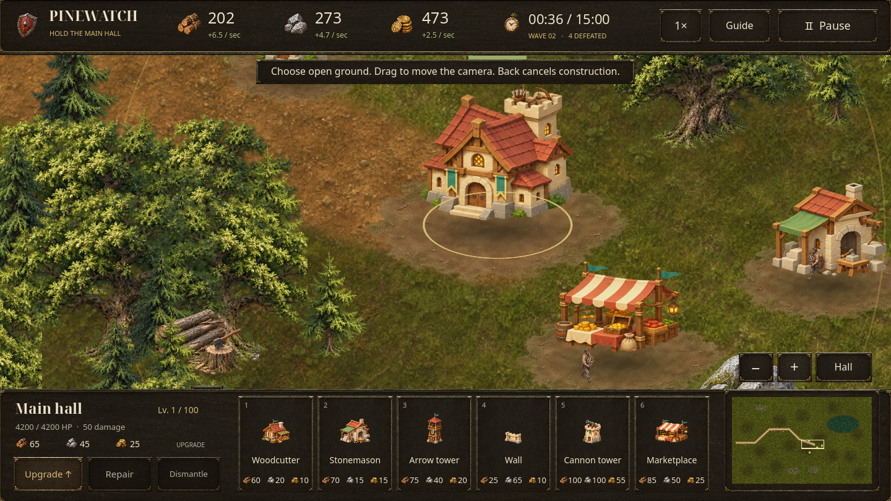

# Tabara: Last Hearth — The Pinewatch Frontier

An offline Android settlement-defense game built in **Godot 4.6.3**. Establish a
foothold in a large wooded valley, gather supplies, place your own defenses, and
hold the main hall for **15 in-game minutes**. Victory unlocks endless survival.



## The frontier revision

Version **0.2.0** replaces the original fixed plots with an **8,192 × 5,120** world,
about **54 times the original map area**. Buildings use free placement on clear
land. Pan and zoom around forests, quarries, rocky ridges, a lake, and the single
western approach. A minimap provides fast travel across the valley.

The interface uses illustrated resource icons and a textured brass-and-leather
command deck. Terrain, woodland props, four-frame enemy sprites, workers, and
water use original raster art. Buildings collapse into rubble, enemies fall
when killed, and construction clears vegetation around the foundations.

## Play

Download the [tested Android APK](https://github.com/Mirne/Tabara/raw/54666d5b71476fd2e2249cea967b6cc7b41cee3d/builds/tabara-frontier.apk) from GitHub,
or install the local `builds/tabara-frontier.apk`. You can also open `project.godot` in Godot 4.6.3 and
press **F5**. Android 7.0/API 24 or later with OpenGL ES 3.0 is required.
This is a **development-signed test build**. The game is in English and has no
advertising, analytics, accounts, purchases, or runtime network requirement.

1. Start **The Pinewatch Frontier** from the menu. A vanguard is already near
   the settlement; the main hall attacks automatically.
2. Tap the wood, stone, and gold deposits to gather supplies. They refill every
   12 seconds. Build producers for steady income.
3. Choose a construction card, then tap clear ground. Buildings are not limited
   to plots. Drag to pan, pinch or use **+ / −** to zoom, and tap the minimap to
   travel. **Hall** returns to your headquarters.
4. Place walls across the approach and cover them with arrow and cannon towers.
   Enemies form a physical crowd rather than occupying identical positions.
   Every fifth wave brings a larger horde.
5. Select a structure to upgrade or repair it. Every structure reaches **level
   100**, with increasing health, output or damage and construction costs.
6. Hold the hall until **15:00**, then choose endless survival. Losing the hall
   ends the settlement.

Water, rocky ridges, resource cores, and existing foundations cannot be built
on. New construction takes 2.5 seconds. The world supports 512 structures.

### Buildings

| Building | Role |
| --- | --- |
| Main hall | Prebuilt headquarters; attacks from the beginning and supplies passive income |
| Woodcutter | Produces timber; +25% beside a forest resource grove |
| Stonemason | Produces stone; +25% beside a quarry |
| Arrow tower | Fast attacks against individual raiders |
| Wall | Freely placed barrier that attackers must break through |
| Cannon tower | Slow shells with wide area damage |
| Marketplace | Produces gold and permits buying or selling supplies |

Destroyed structures lose their building sprite and leave rubble. They retain
levels and can be repaired. **Dismantle / Clear ruins** completely removes the
foundation after confirmation, allowing a different building on the same ground.
Dismantling a standing structure returns 25% of its original construction price;
upgrade costs are not refunded. Trees cleared by construction remain cleared.

### Controls and saves

Android: tap to interact, one-finger drag to pan, two-finger pinch to zoom. Back
cancels construction or toggles pause. Desktop: mouse drag or **WASD / arrows**
pans; the wheel zooms; **1–6** select construction, **U** upgrades, **R** repairs,
**F** finds the hall, **Space** pauses, and **Esc** goes back.

The game saves every 10 real seconds, on pause, when backgrounded, and on return
to the menu. Continue restores buildings, ruins, enemies, economy, cleared
vegetation, camera, and zoom. Returning from another app requires explicit
resume. Settings include sound, music, and reduced motion.

The expanded map uses a **new frontier save format**. The earlier fixed-plot
settlement is not migrated or loaded; its original save file is left intact.
Starting a new frontier requires confirmation when a live frontier save exists.

## Build

Install Godot **4.6.3** and matching export templates, an Android SDK with
**build-tools 36.0.0**, and OpenJDK 17 or 21. Set SDK and Java paths in Godot's
**Editor Settings → Export → Android**. ETC2/ASTC imports are already enabled.

```sh
godot --headless --editor --path . --import --quit
mkdir -p builds
godot --headless --path . --export-debug Android builds/tabara-frontier.apk
```

The preset includes ARMv7, ARM64, and x86-64. A local development signing key is
excluded from source control. A Play Store release needs the owner's release
keystore and a Gradle AAB export. No production key is included.

```sh
godot --headless --path . --export-release Linux builds/tabara-frontier.x86_64
```

## Verify

Use a separate `XDG_DATA_HOME` for automated tests: they save test settlements.

```sh
# Syntax, free placement, economy, combat, level 100, ruins, saves and campaign.
python3 tools/verify.py

# Real rendered menu, mouse/touch, gestures, camera and lifecycle interactions.
python3 tools/verify.py --ui

# Normal-cost player bot, rendered world tours, saves and cold restoration.
godot --path . --max-fps 30 --script res://tests/soak.gd -- --seconds=14400

# Explicit extreme-load fixture: 512 structures and 1,000 high-health enemies.
# This fixture grants resources; it is not a campaign balance test.
godot --path . --max-fps 30 --script res://tests/stress.gd
```

The soak report records confirmed running time, excludes frame gaps over two
seconds, and records excluded stalls separately. `--resume` restores the last
saved settlement and adds only previously confirmed time; `--report-name=name`
selects another report. A short check can use `--seconds=65`.

`tests/android_smoke.py` installs the APK on a disposable emulator and checks
actual touch construction, save coordinates, pause, Back, cold restart, camera
dragging, and background/foreground behavior. Set `ANDROID_ADB`, `ANDROID_SERIAL`,
`ANDROID_ADB_PORT`, `ANDROID_APK`, and `ANDROID_REPORT_NAME` as needed. It clears
only this game's data on that test emulator. `tests/android_back.py` provides a
fresh-activity Back check using an existing saved frontier.

The manually triggered native Android GitHub workflow uses an accelerated
emulator. Local results and device limitations are in the [QA record](docs/QA.md).

## Project structure

- `scripts/simulation.gd`: deterministic fixed-step economy, combat, crowd
  spacing, free placement, progression, spatial indexes, and save validation.
- `scripts/world_data.gd`: shared geography, deposits, scenery, and terrain rules.
- `scripts/frontier_game.gd`: screens, illustrated HUD, input, camera, saves,
  audio, and Android lifecycle handling.
- `scripts/frontier_view.gd`: culled, depth-sorted raster world and combat effects.
- `scripts/frontier_art.gd`: sprite regions and native nine-patch interface skins.
- `scripts/frontier_ground.gdshader`: cached terrain material composition.
- `scripts/frontier_water.gdshader`: animated lake surface.
- `assets/frontier/`: original raster materials, props, units, icons and menu art.
- `tests/`: model, rendered UI, native Android, normal-cost bot, soak and stress.

See [art credits](docs/ASSETS.md), [rules and architecture](docs/DESIGN.md), and
[verification evidence and limitations](docs/QA.md).
