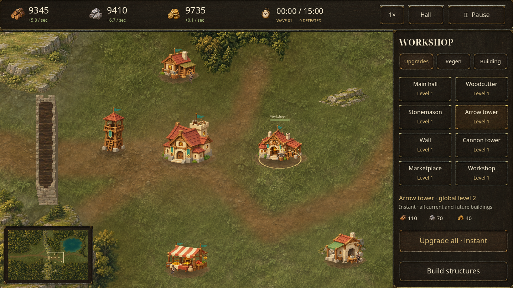

# Tabara: Last Hearth — Open Approach

An offline Android settlement-defense game built in **Godot 4.6.3**. Build a
settlement in a wooded valley, gather supplies, and defend the main hall for
**15 in-game minutes**. Victory unlocks endless survival.



## Version 0.9

Workshop upgrades now apply **instantly** to all existing and future buildings.
There is no research timer or queue. The Workshop's **Regen** tab unlocks automatic
global Regeneration, replacing manual repairs. At level one it restores 0.30% of
maximum health per game second to every completed, standing building; each level
adds 0.015 percentage points. Completed upgrades persist if the Workshop falls.
Destroyed buildings disappear and must be built again.

Construction tools stay active after confirmation. Place another tower with a
location tap and confirmation, then use **Done building** to leave the tool.
Buildings are not automatically selected after construction. A wall drag skips
blocked terrain and charges only eligible sections. Adjacent rows share one
raised deck and outside parapet, including solid 3×3 blocks.

A Warlord miniboss enters from the western entrance every **five game minutes**,
including endless mode. It has much higher ordinary health and attack, its own
animated sprite and health bar, and uses the same incoming damage rules as other
raiders. Elites retain ordinary cannon splash and arrow damage too.

The eight production sites remain limited to two timber sites and two quarries
inside the base, plus two of each outside. They now sit off the painted paths and
leave the mountain opening and the former near-pass logging foundation clear for
walls. All ordinary open ground remains reachable by enemies. The map is
8,192 × 5,120 units, with one western entry and a 480-unit mountain pass.


## Play on Android

Download the [tested Android APK](https://raw.githubusercontent.com/Mirne/Tabara/main/builds/tabara-frontier-v0.9.apk)
from GitHub. Open the link in Chrome, then open `tabara-frontier-v0.9.apk` from
**Downloads** or Samsung **My Files → Downloads**. Install it over the previous
version to retain the settlement. **Start a new settlement for the repositioned resource
map**; existing saves keep their original terrain and producer sites.

ARM64 and x86-64, Android 7.0/API 24 or later, OpenGL ES 3.0. The S23 Ultra is
supported. This is a development-signed sideload build. No accounts, purchases,
advertising, analytics, or runtime network connection are required.

1. Start Hearthvale Basin. Enemies spawn immediately at the western entrance;
   the main hall fires automatically when they reach its range.
2. Build producers on their matching sites. Resources are scenery and cannot be
   clicked. Producers and the hall supply materials; kills award gold.
3. Establish a wall line covered by arrow and cannon towers. Every fifth wave is
   a great horde. Attackers route around impassable terrain and destroy buildings
   blocking them. Red cells reject construction and block passage.
4. Build a Workshop for global upgrades. Unlock Regeneration for automatic healing. The Marketplace trades gold for supplies, or supplies for gold, with
   a cooldown between orders.
5. Survive to 15:00, then continue until the hall falls.

| Building | Role |
| --- | --- |
| Main hall | Headquarters, automatic arrows and modest passive income |
| Woodcutter | Timber income, one per timber site |
| Stonemason | Stone income, one per quarry |
| Arrow tower | Rapid single-target damage |
| Wall | Joined, draggable fortification sections |
| Cannon tower | Slower area damage |
| Marketplace | Buy and sell supplies; one per settlement |
| Workshop | Instant global upgrades and automatic Regeneration; one per settlement |

Drag to pan, pinch to zoom, and tap the minimap to travel. **Hall** returns to the
headquarters. Speed cycles **1× → 2× → 5× → 10×**. Android Back cancels placement
or toggles pause. Desktop: drag or WASD/arrows pan, wheel zooms, **1–7** select
construction, **U** opens the Workshop, **R** opens Regeneration, **F** finds the hall,
**Space** pauses, and **Esc** goes back.

The game saves every ten real seconds, on pause, when backgrounded, and when
returning to the menu. Foregrounding requires explicit resume. Save format eight
loads frontier versions 2–7 and preserves their geography and foundations. An
already-paid v0.8 research order completes once on migration; any remaining paid
local repair finishes once before its manual job is removed. Regeneration starts
locked until purchased. Old save times do not trigger a backlog of minibosses.
Version-one fixed-plot saves remain untouched and are not loaded. Starting a new
settlement replaces the active frontier after confirmation.

## Development

Work directly on **main**. Keep the latest tested APK and checksum in `builds/`;
previous downloads and reports remain reachable through [release history](docs/HISTORY.md).
No feature or download branches are needed. Signing keys and toolchains stay
outside Git.

Open `project.godot` in Godot 4.6.3 and press F5. For Android, install matching
export templates, SDK build-tools 36.0.0 and OpenJDK 17 or 21. Configure Android
SDK and Java paths in Godot's Editor Settings.

```sh
godot --headless --editor --single-threaded-scene --path . --import --quit
mkdir -p builds
godot --headless --path . --export-debug Android builds/tabara-frontier-v0.9-unpacked.apk
python3 tools/package_android.py builds/tabara-frontier-v0.9-unpacked.apk builds/tabara-frontier-v0.9.apk --sdk "$ANDROID_HOME"
```

The packaging tool losslessly ZIP-compresses texture containers, verifies every
payload, aligns the package, and signs it with the existing development key.
Texture pixels and scripts are unchanged. A Play Store release requires the
owner's production key and a Gradle AAB export; no production key is included.

Use an isolated `XDG_DATA_HOME`: tests write test settlements.

```sh
python3 tools/verify.py --ui
godot --headless --path . --script res://tests/balance.gd -- --seeds=3
godot --path . --max-fps 30 --script res://tests/soak.gd -- --seconds=300
godot --path . --max-fps 30 --script res://tests/stress.gd -- --seconds=65
```

Balance and soak use a normal-cost player bot. Stress explicitly grants resources
and creates 512 structures plus 1,000 high-health enemies; it is not a balance
claim. Soak records confirmed active time and excludes long stalls.

`tests/android_smoke.py` installs the actual APK on a disposable emulator and
checks touch placement, green tiles, filtered walls, instant upgrades, Regeneration, minibosses, pause,
Back, saves, restart, panning and app switching. Configure `ANDROID_ADB`,
`ANDROID_SERIAL`, `ANDROID_ADB_PORT`, `ANDROID_APK`, `ANDROID_REPORT_NAME` and
`ANDROID_COMMAND_TIMEOUT` and `ANDROID_TAP_DELAY` as needed. Slower software
emulators can use an eight-second tap delay. It clears only this game's data on that
emulator. `tests/android_upgrade.py` tests the actual v0.8-to-v0.9 install using
`ANDROID_PREVIOUS_APK` and `ANDROID_BASE_REPORT` after native checks pass.

The manually triggered Android GitHub workflow uses an accelerated API 35 emulator.
See [verification evidence and limits](docs/QA.md), [rules and architecture](docs/DESIGN.md),
and [art credits](docs/ASSETS.md).
