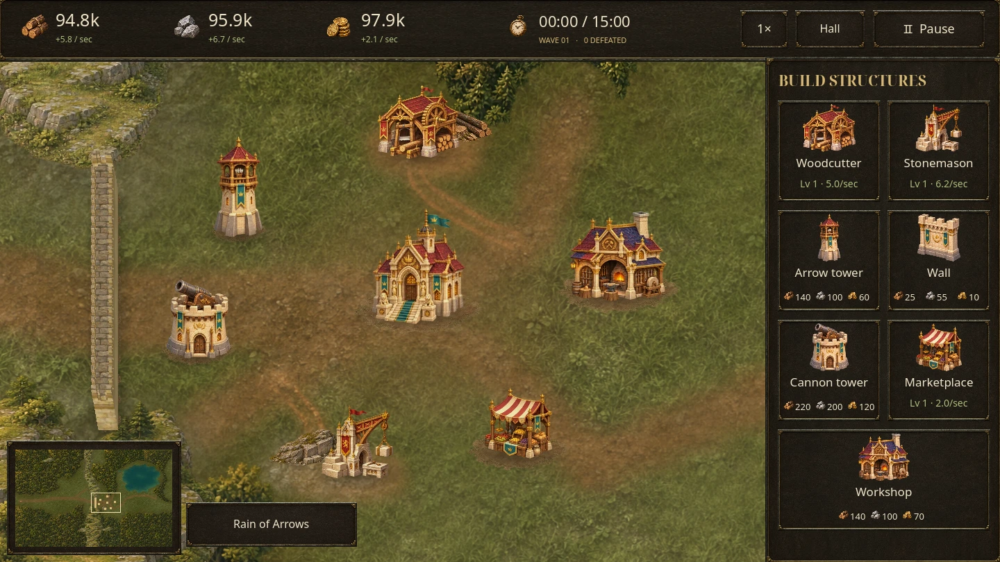

# Tabara: Last Hearth

An offline Android settlement-defense game built in **Godot 4.6.3**. Build a
settlement in a wooded valley, gather supplies, and defend the main hall. Defeat
the **final Warlord arriving at 15:00** to unlock endless survival.



## Version 0.13

Every settlement starts in **Wood**. Tap **Hall → Age** to preview the next
Hall, see which research it unlocks, and spend wood, stone and gold to advance. Stone, Iron, Steel,
Keep, Castle, Citadel and Crown each bring new paintings for buildings, walls
and Workshop projects. The Hall's **Building** tab upgrades its health and weapon.

In Wood, the Workshop offers **Arrowheads** for arrow damage and **Round shot**
for cannon damage. Stone adds arrow range and cannon blast radius. Iron adds
faster firing and reloading. Later ages raise the maximum research rank. Each
project shows the current stat, the next stat and the price. Arrowheads also
improves Rain of Arrows. [See the age progression and playtest plan](docs/AGE-REWORK.md).

A new settlement has one timber yard below the northern forest and one quarry
at the southern limestone shelf. Build on the matching site, then use that
producer's catalogue card to open its local upgrades. Increasing output makes
the same yard more productive. A destroyed producer can be rebuilt at level one.
Earlier saves keep their original geography, standing producers and paid levels.

## Play on Android

Download the signed Android APK from the [latest Tabara release on GitHub](https://github.com/Mirne/Tabara/releases/latest).
On Samsung, open the APK from **My Files → Downloads**. Choose **Update**
when installing over an earlier version to keep your settlement.

ARM64 and x86-64, Android 7.0/API 24 or later, OpenGL ES 3.0. The S23 Ultra is
supported. This is a development-signed sideload build. No accounts, purchases,
advertising, analytics, or runtime network connection are required.

1. Start Hearthvale Basin. Enemies spawn immediately at the western entrance;
   the main hall fires automatically when they reach its range.
2. Build producers on their matching sites. Resources are scenery and cannot be
   clicked. Producers and the hall supply materials; kills award gold.
3. Establish a wall line covered by arrow and cannon towers. Every fifth wave is
   a great horde. Attackers route around impassable terrain and destroy buildings
   blocking them. Red cells reject construction and block passage.
4. Use Rain of Arrows against clustered enemies; preview and confirm its circle.
   Upgrade producers at their own panels. Build a Marketplace for passive gold.
   Advance the Hall to open new tower research. The Workshop also upgrades walls and Regeneration.
5. Defeat the final Warlord arriving at 15:00, then continue until the hall falls.

| Building | Role |
| --- | --- |
| Main hall | Age advancement, automatic arrows and starting income |
| Woodcutter | Timber income from the northern working forest |
| Stonemason | Stone income from the limestone yard |
| Arrow tower | Rapid single-target damage |
| Wall | Single-cell, joined draggable fortifications |
| Cannon tower | Slower area damage |
| Marketplace | Passive gold production and income upgrades; one per settlement |
| Workshop | Tower research, wall upgrades and automatic Regeneration |

Drag to pan, pinch to zoom, and tap the minimap to travel. **Hall** returns to the
headquarters. Speed cycles **1× → 2× → 5× → 10×**. Android Back cancels placement
or toggles pause. Desktop: drag or WASD/arrows pan, wheel zooms, **1–7** select
construction, **U** opens the Workshop, **R** opens Regeneration, **F** finds the hall,
**Space** pauses, and **Esc** goes back.

The game saves every ten real seconds, on pause, when backgrounded and when
returning to the menu. After foregrounding, tap Resume. Save format 12 loads
frontier versions 2–11. Existing tower purchases keep their effects when
the new research tracks appear. Older saved settlements also retain their
foundations, producer levels, Regeneration purchases and earned endless
victories. Starting a new settlement replaces the active one after confirmation.
Details of earlier formats are in [save migration](docs/gameplay/upgrades.md).

## Development

Read the [owner's instructions](docs/gameplay/NOTES.md) and the affected
[building and NPC specifications](docs/gameplay/INDEX.md) before editing.
Work directly on **main**. Keep the latest tested APK and checksum in `builds/`
and signing keys outside Git. Previous versions and their verification records
are linked from [release history](docs/HISTORY.md).

Open `project.godot` in Godot 4.6.3 and press F5. For Android, install matching
export templates, SDK build-tools 36.0.0 and OpenJDK 17 or 21. Configure Android
SDK and Java paths in Godot's Editor Settings.

```sh
godot --headless --editor --single-threaded-scene --path . --import --quit
mkdir -p builds
godot --headless --path . --export-release Android builds/tabara-frontier-v0.13-unpacked.apk
python3 tools/package_android.py builds/tabara-frontier-v0.13-unpacked.apk builds/tabara-frontier-v0.13.apk --sdk "$ANDROID_HOME"
```

Set the Godot Android release keystore environment variables before exporting.
The signer passed to `tools/package_android.py` must match the installed game's
certificate for an update to retain a settlement. Set `--keystore` and supply
`TABARA_KEY_ALIAS` and `TABARA_KEY_PASSWORD` for a non-default development key.
The tool compresses texture containers, verifies all uncompressed payloads,
aligns the APK and signs it. Keep certificate credentials outside Git.

Use an isolated `XDG_DATA_HOME`: tests write test settlements.

```sh
python3 tools/verify.py --ui
godot --headless --path . --script res://tests/balance.gd -- --seeds=3
godot --path . --max-fps 30 --script res://tests/soak.gd -- --seconds=300
godot --path . --max-fps 30 --script res://tests/stress.gd -- --seconds=65
```

Balance and soak use a normal-cost player bot. Stress explicitly grants resources
and creates 512 structures plus 1,000 high-health enemies; it is not a balance
claim. Soak records confirmed active time and excludes long stalls.

`tests/android_smoke.py` installs the actual APK on a disposable emulator and
checks touch placement, green tiles, filtered walls, instant upgrades, Regeneration, minibosses, pause,
Back, saves, restart, panning and app switching. Configure `ANDROID_ADB`,
`ANDROID_SERIAL`, `ANDROID_ADB_PORT`, `ANDROID_APK`, `ANDROID_REPORT_NAME` and
`ANDROID_COMMAND_TIMEOUT` and `ANDROID_TAP_DELAY` as needed. Slower software
emulators can use an eight-second tap delay. It clears only this game's data on that
emulator. For a release template, use a disposable rooted AOSP emulator with
`adb root` and `ANDROID_TEST_ROOT=1` so the harness can verify the app's saved
state. `tests/android_upgrade.py` installs published v0.12, updates it in place,
checks the legacy producers and tower purchases, then exercises all seven age
advancements with a controlled budget. Set `ANDROID_PREVIOUS_APK` to the old
APK and `ANDROID_APK` to the new signed APK. The harness restores the original
settlement after its controlled checks.

The manually triggered Android GitHub workflow checks the APK's published
checksum, then installs that file on API 24 and API 35 emulators. See the
[verification record](docs/QA.md), [game design](docs/DESIGN.md) and
[art credits](docs/ASSETS.md).
