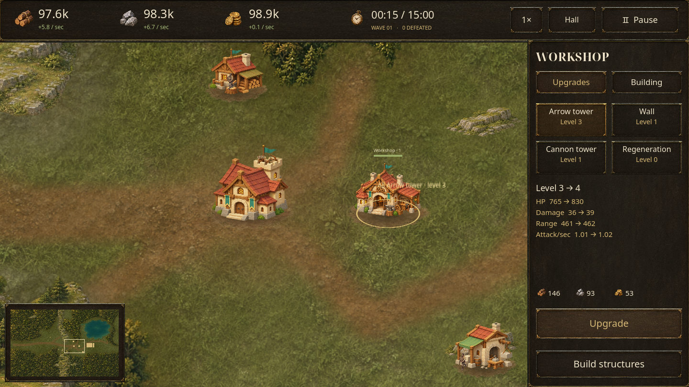

# Tabara: Last Hearth

An offline Android settlement-defense game built in **Godot 4.6.3**. Build a
settlement in a wooded valley, gather supplies, and defend the main hall for
**15 in-game minutes**. Victory unlocks endless survival.



## Version 0.10

Marketplace produces **2 gold per game second**, with individual income upgrades.
Buying, selling and trade cooldowns are removed. Woodcutters, quarries, the Hall,
Marketplace and Workshop upgrade from their own panels. Walls and both tower
types retain global Workshop upgrades. Regeneration is in that same Upgrades
list: it starts at 0.3% maximum HP/sec and reaches **20% at level 100**.

Building panels show actual current/next effects and prices. Purchase buttons say
**Upgrade**. Repeated Workshop explanations and routine tutorial popups are removed.
A quarry and its rocks draw as one stable group. Enemies detect resource producers
within 1,600 world units and retarget after an outpost falls, while still attacking
blocking defenses and respecting impassable terrain.

The existing map, building costs, enemy stats, victory time, five-minute minibosses,
continuous construction tools and joined wall geometry are retained. No new
settlement is needed for these changes. Existing buildings keep their levels;
new non-defense buildings start at one. New defenses inherit their global level.

The persistent [owner rules](docs/gameplay/NOTES.md) and [building/NPC specifications](docs/gameplay/INDEX.md)
must be read before implementing further changes.

## Play on Android

Download the [tested Android APK](https://raw.githubusercontent.com/Mirne/Tabara/main/builds/tabara-frontier-v0.10.apk)
from GitHub. Open the link in Chrome, then open `tabara-frontier-v0.10.apk` from
**Downloads** or Samsung **My Files → Downloads**. Install it over the previous
version to retain the settlement. Existing saves retain their terrain, foundations and purchased levels.

ARM64 and x86-64, Android 7.0/API 24 or later, OpenGL ES 3.0. The S23 Ultra is
supported. This is a development-signed sideload build. No accounts, purchases,
advertising, analytics, or runtime network connection are required.

1. Start Hearthvale Basin. Enemies spawn immediately at the western entrance;
   the main hall fires automatically when they reach its range.
2. Build producers on their matching sites. Resources are scenery and cannot be
   clicked. Producers and the hall supply materials; kills award gold.
3. Establish a wall line covered by arrow and cannon towers. Every fifth wave is
   a great horde. Attackers route around impassable terrain and destroy buildings
   blocking them. Red cells reject construction and block passage.
4. Upgrade producers at their own panels. Build a Marketplace for passive gold.
   The Workshop upgrades defenses and Regeneration.
5. Survive to 15:00, then continue until the hall falls.

| Building | Role |
| --- | --- |
| Main hall | Headquarters, automatic arrows and modest passive income |
| Woodcutter | Timber income, one per timber site |
| Stonemason | Stone income, one per quarry |
| Arrow tower | Rapid single-target damage |
| Wall | Joined, draggable fortification sections |
| Cannon tower | Slower area damage |
| Marketplace | Passive gold production and income upgrades; one per settlement |
| Workshop | Global defense upgrades and Regeneration; one per settlement |

Drag to pan, pinch to zoom, and tap the minimap to travel. **Hall** returns to the
headquarters. Speed cycles **1× → 2× → 5× → 10×**. Android Back cancels placement
or toggles pause. Desktop: drag or WASD/arrows pan, wheel zooms, **1–7** select
construction, **U** opens the Workshop, **R** opens Regeneration, **F** finds the hall,
**Space** pauses, and **Esc** goes back.

The game saves every ten real seconds, on pause, when backgrounded, and when
returning to the menu. Foregrounding requires explicit resume. Save format nine
loads frontier versions 2–8 and preserves their geography, foundations and levels. An
already-paid v0.8 research order completes once on migration; any remaining paid
local repair finishes once before its manual job is removed. Previously purchased Regeneration levels are retained; it stays locked when
not previously purchased. Old save times do not trigger a backlog of minibosses.
Version-one fixed-plot saves remain untouched and are not loaded. Starting a new
settlement replaces the active frontier after confirmation.

## Development

Read [the gameplay specifications](docs/gameplay/INDEX.md) before editing.
Work directly on **main**. Keep the latest tested APK and checksum in `builds/`;
previous downloads and reports remain reachable through [release history](docs/HISTORY.md).
No feature or download branches are needed. Signing keys and toolchains stay
outside Git.

Open `project.godot` in Godot 4.6.3 and press F5. For Android, install matching
export templates, SDK build-tools 36.0.0 and OpenJDK 17 or 21. Configure Android
SDK and Java paths in Godot's Editor Settings.

```sh
godot --headless --editor --single-threaded-scene --path . --import --quit
mkdir -p builds
godot --headless --path . --export-debug Android builds/tabara-frontier-v0.10-unpacked.apk
python3 tools/package_android.py builds/tabara-frontier-v0.10-unpacked.apk builds/tabara-frontier-v0.10.apk --sdk "$ANDROID_HOME"
```

The packaging tool losslessly ZIP-compresses texture containers, verifies every
payload, aligns the package, and signs it with the existing development key.
Texture pixels and scripts are unchanged. A Play Store release requires the
owner's production key and a Gradle AAB export; no production key is included.

Use an isolated `XDG_DATA_HOME`: tests write test settlements.

```sh
python3 tools/verify.py --ui
godot --headless --path . --script res://tests/balance.gd -- --seeds=3
godot --path . --max-fps 30 --script res://tests/soak.gd -- --seconds=300
godot --path . --max-fps 30 --script res://tests/stress.gd -- --seconds=65
```

Balance and soak use a normal-cost player bot. Stress explicitly grants resources
and creates 512 structures plus 1,000 high-health enemies; it is not a balance
claim. Soak records confirmed active time and excludes long stalls.

`tests/android_smoke.py` installs the actual APK on a disposable emulator and
checks touch placement, green tiles, filtered walls, instant upgrades, Regeneration, minibosses, pause,
Back, saves, restart, panning and app switching. Configure `ANDROID_ADB`,
`ANDROID_SERIAL`, `ANDROID_ADB_PORT`, `ANDROID_APK`, `ANDROID_REPORT_NAME` and
`ANDROID_COMMAND_TIMEOUT` and `ANDROID_TAP_DELAY` as needed. Slower software
emulators can use an eight-second tap delay. It clears only this game's data on that
emulator. `tests/android_upgrade.py` installs the published v0.9 APK, migrates its save to
v0.10, and tests local producer/Marketplace upgrades and passive income. Set
`ANDROID_PREVIOUS_APK` to the old download. Its later UI fixture explicitly grants
supplies; migration retains the original economy and restores it afterward.

The manually triggered Android GitHub workflow uses an accelerated API 35 emulator.
See [verification evidence and limits](docs/QA.md), [rules and architecture](docs/DESIGN.md),
and [art credits](docs/ASSETS.md).
