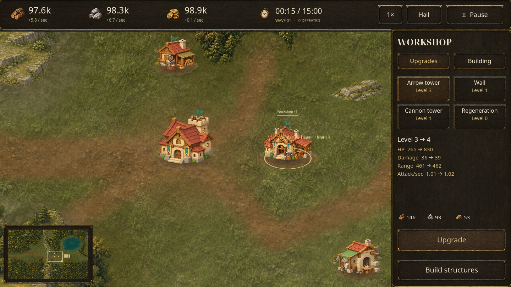

# Tabara: Last Hearth

An offline Android settlement-defense game built in **Godot 4.6.3**. Build a
settlement in a wooded valley, gather supplies, and defend the main hall. Defeat
the **final Warlord arriving at 15:00** to unlock endless survival.



## Version 0.11

All six attacking enemy types have painted wind-up, strike and recovery frames.
Walking and attacking units mirror when they face left. Attack pacing and ordinary
enemy damage are unchanged. The launcher and startup image use a new painted Hall
icon. The decorative SINGLE PLAYER / OFFLINE menu footer is removed.

Warlords enter every five game minutes and grow stronger. The 10:00 miniboss is
stronger than the 05:00 one; the 15:00 final Warlord has four times the old
same-wave boss's health and twice its damage. Reaching 15:00 keeps the battle
running. Victory requires killing that specific boss while the Hall survives;
endless mode then continues with further five-minute bosses.

Existing unfinished settlements adopt the final-boss objective. Completed old
endless settlements retain their earned victory; start a new settlement to play
the revised objective after an old win. Terrain, foundations, purchased upgrades,
passive Marketplace income and all unspecified mechanics are retained.

The persistent [owner rules](docs/gameplay/NOTES.md) and [building/NPC specifications](docs/gameplay/INDEX.md)
must be read before implementing further changes.

## Play on Android

Download the [tested Android APK](https://raw.githubusercontent.com/Mirne/Tabara/main/builds/tabara-frontier-v0.11.apk)
from GitHub. Open the link in Chrome, then open `tabara-frontier-v0.11.apk` from
**Downloads** or Samsung **My Files → Downloads**. Install it over the previous
version to retain the settlement. Existing saves retain their terrain, foundations and purchased levels.

ARM64 and x86-64, Android 7.0/API 24 or later, OpenGL ES 3.0. The S23 Ultra is
supported. This is a development-signed sideload build. No accounts, purchases,
advertising, analytics, or runtime network connection are required.

1. Start Hearthvale Basin. Enemies spawn immediately at the western entrance;
   the main hall fires automatically when they reach its range.
2. Build producers on their matching sites. Resources are scenery and cannot be
   clicked. Producers and the hall supply materials; kills award gold.
3. Establish a wall line covered by arrow and cannon towers. Every fifth wave is
   a great horde. Attackers route around impassable terrain and destroy buildings
   blocking them. Red cells reject construction and block passage.
4. Upgrade producers at their own panels. Build a Marketplace for passive gold.
   The Workshop upgrades defenses and Regeneration.
5. Defeat the final Warlord arriving at 15:00, then continue until the hall falls.

| Building | Role |
| --- | --- |
| Main hall | Headquarters, automatic arrows and modest passive income |
| Woodcutter | Timber income, one per timber site |
| Stonemason | Stone income, one per quarry |
| Arrow tower | Rapid single-target damage |
| Wall | Joined, draggable fortification sections |
| Cannon tower | Slower area damage |
| Marketplace | Passive gold production and income upgrades; one per settlement |
| Workshop | Global defense upgrades and Regeneration; one per settlement |

Drag to pan, pinch to zoom, and tap the minimap to travel. **Hall** returns to the
headquarters. Speed cycles **1× → 2× → 5× → 10×**. Android Back cancels placement
or toggles pause. Desktop: drag or WASD/arrows pan, wheel zooms, **1–7** select
construction, **U** opens the Workshop, **R** opens Regeneration, **F** finds the hall,
**Space** pauses, and **Esc** goes back.

The game saves every ten real seconds, on pause, when backgrounded, and when
returning to the menu. Foregrounding requires explicit resume. Save format ten
loads frontier versions 2–9 and preserves their geography, foundations and levels. An
already-paid v0.8 research order completes once on migration; any remaining paid
local repair finishes once before its manual job is removed. Previously purchased Regeneration levels are retained; it stays locked when
not previously purchased. Old save times do not trigger a backlog of minibosses.
Version-one fixed-plot saves remain untouched and are not loaded. Starting a new
settlement replaces the active frontier after confirmation.

## Development

Read [the gameplay specifications](docs/gameplay/INDEX.md) before editing.
Work directly on **main**. Keep the latest tested APK and checksum in `builds/`;
previous downloads and reports remain reachable through [release history](docs/HISTORY.md).
No feature or download branches are needed. Signing keys and toolchains stay
outside Git.

Open `project.godot` in Godot 4.6.3 and press F5. For Android, install matching
export templates, SDK build-tools 36.0.0 and OpenJDK 17 or 21. Configure Android
SDK and Java paths in Godot's Editor Settings.

```sh
godot --headless --editor --single-threaded-scene --path . --import --quit
mkdir -p builds
godot --headless --path . --export-debug Android builds/tabara-frontier-v0.11-unpacked.apk
python3 tools/package_android.py builds/tabara-frontier-v0.11-unpacked.apk builds/tabara-frontier-v0.11.apk --sdk "$ANDROID_HOME"
```

The packaging tool losslessly ZIP-compresses texture containers, verifies every
payload, aligns the package, and signs it with the existing development key.
Texture pixels and scripts are unchanged. A Play Store release requires the
owner's production key and a Gradle AAB export; no production key is included.

Use an isolated `XDG_DATA_HOME`: tests write test settlements.

```sh
python3 tools/verify.py --ui
godot --headless --path . --script res://tests/balance.gd -- --seeds=3
godot --path . --max-fps 30 --script res://tests/soak.gd -- --seconds=300
godot --path . --max-fps 30 --script res://tests/stress.gd -- --seconds=65
```

Balance and soak use a normal-cost player bot. Stress explicitly grants resources
and creates 512 structures plus 1,000 high-health enemies; it is not a balance
claim. Soak records confirmed active time and excludes long stalls.

`tests/android_smoke.py` installs the actual APK on a disposable emulator and
checks touch placement, green tiles, filtered walls, instant upgrades, Regeneration, minibosses, pause,
Back, saves, restart, panning and app switching. Configure `ANDROID_ADB`,
`ANDROID_SERIAL`, `ANDROID_ADB_PORT`, `ANDROID_APK`, `ANDROID_REPORT_NAME` and
`ANDROID_COMMAND_TIMEOUT` and `ANDROID_TAP_DELAY` as needed. Slower software
emulators can use an eight-second tap delay. It clears only this game's data on that
emulator. `tests/android_upgrade.py` installs the published v0.10 APK, migrates its save to
v0.11, and checks native left/right attacks, the 15:00 arrival, final-boss victory
and endless mode. Set `ANDROID_PREVIOUS_APK` to the old download. Encounter fixtures
advance the clock, reposition enemies, reinforce walls and lower final-boss HP
for a tower kill. They do not represent a normal campaign. The original migrated
settlement is restored afterward.

The manually triggered Android GitHub workflow uses an accelerated API 35 emulator.
See [verification evidence and limits](docs/QA.md), [rules and architecture](docs/DESIGN.md),
and [art credits](docs/ASSETS.md).
