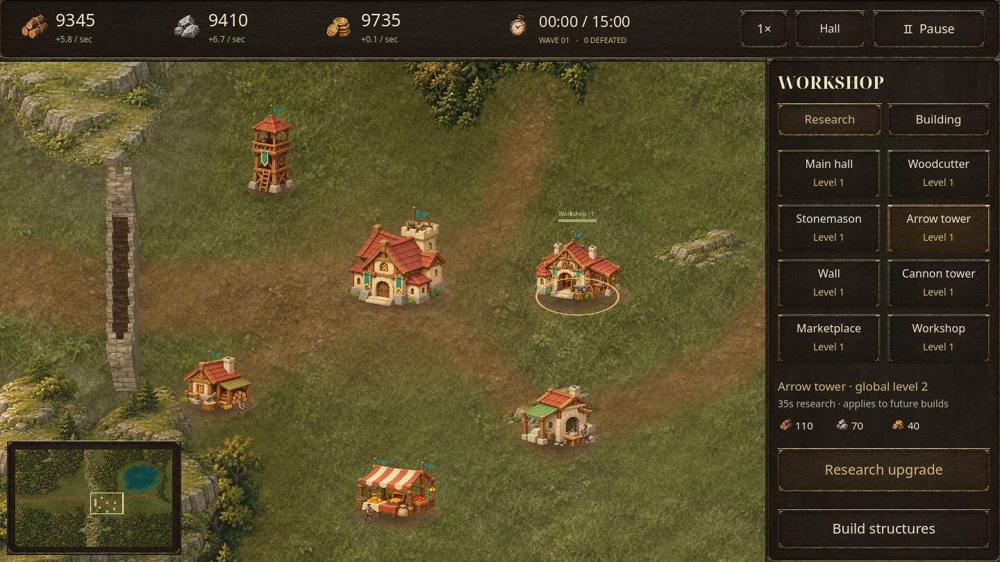
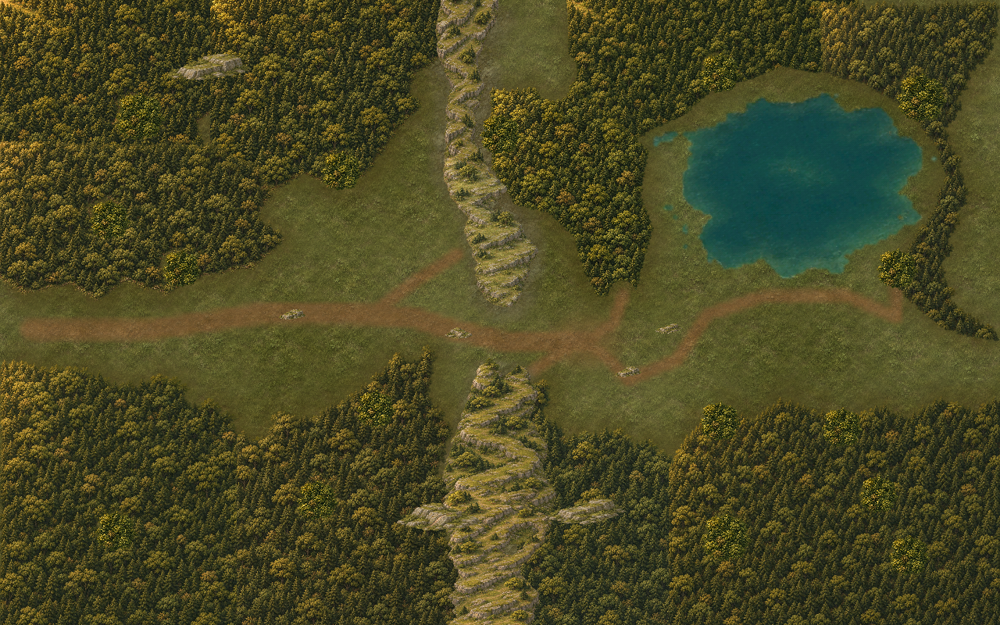

# Tabara: Last Hearth — Stronghold

An offline Android settlement-defense game built in **Godot 4.6.3**. Build a
settlement in a wooded valley, gather supplies, and defend the main hall for
**15 in-game minutes**. Victory unlocks endless survival.



## Version 0.8

The woodland basin now has limited production sites: **two timber sites and two
quarries inside the base, plus two of each outside on the exposed western side**.
Dense forest and sealed woodland gaps reject construction and block movement.
Every ordinary buildable clearing connects to the hall and can be reached by
attackers. The map remains 8,192 × 5,120 units, with one western entry and a
480-unit mountain pass that six joined wall sections can seal.

Selecting a construction tool or existing building replaces the right-hand
catalogue with larger mobile controls. Woodcutter and stonemason tools show valid
sites as green tiles inside a clear rectangle. A tap previews; **Build · Confirm**
spends the displayed cost. Tower previews show attack range. Drag walls to preview
an entire joined run and its total price before confirming.

The new **Workshop** researches global levels for all eight building types,
including future replacements. One paid order runs at a time, beginning at
35 seconds and taking longer at higher levels. Levels reach 100. Repairs remain
local, take eight game seconds, and work only on standing buildings. Destroyed
buildings disappear and free their foundations; replacements inherit completed
research. Enemies retaliate against reachable defenses that fire at them and
break intervening walls. Elite raiders join great hordes from wave five. Their
higher health and attack make them stronger; arrows and cannon splash apply
ordinary damage, without special resistances or weapon bonuses.



## Play on Android

Download the [tested Android APK](https://raw.githubusercontent.com/Mirne/Tabara/main/builds/tabara-frontier-v0.8.apk)
from GitHub. Open the link in Chrome, then open `tabara-frontier-v0.8.apk` from
**Downloads** or Samsung **My Files → Downloads**. Install it over the previous
version to retain the settlement. **Start a new settlement for the eight-site
map**; existing saves keep their original terrain and producer sites.

ARM64 and x86-64, Android 7.0/API 24 or later, OpenGL ES 3.0. The S23 Ultra is
supported. This is a development-signed sideload build. No accounts, purchases,
advertising, analytics, or runtime network connection are required.

1. Start Hearthvale Basin. Enemies spawn immediately at the western entrance;
   the main hall fires automatically when they reach its range.
2. Build producers on their matching sites. Resources are scenery and cannot be
   clicked. Producers and the hall supply materials; kills award gold.
3. Establish a wall line covered by arrow and cannon towers. Every fifth wave is
   a great horde. Attackers route around impassable terrain and destroy buildings
   blocking them. Red cells reject construction and block passage.
4. Build a Workshop for global upgrades. Select damaged buildings for local
   repairs. The Marketplace trades gold for supplies, or supplies for gold, with
   a cooldown between orders.
5. Survive to 15:00, then continue until the hall falls.

| Building | Role |
| --- | --- |
| Main hall | Headquarters, automatic arrows and modest passive income |
| Woodcutter | Timber income, one per timber site |
| Stonemason | Stone income, one per quarry |
| Arrow tower | Rapid single-target damage |
| Wall | Joined, draggable fortification sections |
| Cannon tower | Slower area damage |
| Marketplace | Buy and sell supplies; one per settlement |
| Workshop | Timed global research; one per settlement |

Drag to pan, pinch to zoom, and tap the minimap to travel. **Hall** returns to the
headquarters. Speed cycles **1× → 2× → 5× → 10×**. Android Back cancels placement
or toggles pause. Desktop: drag or WASD/arrows pan, wheel zooms, **1–7** select
construction, **U** opens the Workshop, **R** repairs, **F** finds the hall,
**Space** pauses, and **Esc** goes back.

The game saves every ten real seconds, on pause, when backgrounded, and when
returning to the menu. Foregrounding requires explicit resume. Save format seven
loads frontier versions 2–6, preserves their geography, and converts the highest
surviving upgrade level of each building type into global research. Old destroyed
non-hall ruins are removed. Version-one fixed-plot saves remain untouched and are
not loaded. Starting a new settlement replaces the active frontier after confirmation.

## Development

Work directly on **main**. Keep the latest tested APK and checksum in `builds/`;
previous downloads and reports remain reachable through [release history](docs/HISTORY.md).
No feature or download branches are needed. Signing keys and toolchains stay
outside Git.

Open `project.godot` in Godot 4.6.3 and press F5. For Android, install matching
export templates, SDK build-tools 36.0.0 and OpenJDK 17 or 21. Configure Android
SDK and Java paths in Godot's Editor Settings.

```sh
godot --headless --editor --single-threaded-scene --path . --import --quit
mkdir -p builds
godot --headless --path . --export-debug Android builds/tabara-frontier-v0.8-unpacked.apk
python3 tools/package_android.py builds/tabara-frontier-v0.8-unpacked.apk builds/tabara-frontier-v0.8.apk --sdk "$ANDROID_HOME"
```

The packaging tool losslessly ZIP-compresses texture containers, verifies every
payload, aligns the package, and signs it with the existing development key.
Texture pixels and scripts are unchanged. A Play Store release requires the
owner's production key and a Gradle AAB export; no production key is included.

Use an isolated `XDG_DATA_HOME`: tests write test settlements.

```sh
python3 tools/verify.py --ui
godot --headless --path . --script res://tests/balance.gd -- --seeds=3
godot --path . --max-fps 30 --script res://tests/soak.gd -- --seconds=300
godot --path . --max-fps 30 --script res://tests/stress.gd -- --seconds=65
```

Balance and soak use a normal-cost player bot. Stress explicitly grants resources
and creates 512 structures plus 1,000 high-health enemies; it is not a balance
claim. Soak records confirmed active time and excludes long stalls.

`tests/android_smoke.py` installs the actual APK on a disposable emulator and
checks touch placement, green tiles, joined walls, Workshop research, pause,
Back, saves, restart, panning and app switching. Configure `ANDROID_ADB`,
`ANDROID_SERIAL`, `ANDROID_ADB_PORT`, `ANDROID_APK`, `ANDROID_REPORT_NAME` and
`ANDROID_COMMAND_TIMEOUT` as needed. It clears only this game's data on that
emulator. `tests/android_upgrade.py` tests the actual v0.7-to-v0.8 install using
`ANDROID_PREVIOUS_APK` and `ANDROID_BASE_REPORT` after native checks pass.

The manually triggered Android GitHub workflow uses an accelerated API 35 emulator.
See [verification evidence and limits](docs/QA.md), [rules and architecture](docs/DESIGN.md),
and [art credits](docs/ASSETS.md).
